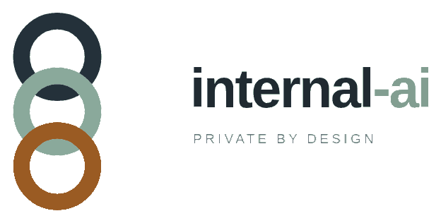

<p align="center">
  <picture>
    <source media="(prefers-color-scheme: dark)" srcset="Logo/internal-ai-lockup-clear-dark.png">
    
  </picture>
</p>

<h1 align="center">internal-ai</h1>

<p align="center"><strong>The control plane a company runs on its own machines to build, evaluate and serve a model it owns.</strong></p>

<p align="center"><code>Python 3.12</code> &nbsp;·&nbsp; <code>FastAPI</code> &nbsp;·&nbsp; <code>htmx, vendored</code> &nbsp;·&nbsp; <code>SQLite</code> &nbsp;·&nbsp; <code>PolyForm Noncommercial 1.0.0</code></p>

<p align="center">
  <a href="#quick-start">Quick start</a> ·
  <a href="#what-it-does">What it does</a> ·
  <a href="#two-tracks">Two tracks</a> ·
  <a href="#what-stays-inside">Guarantees</a> ·
  <a href="#refusals-you-will-meet">Refusals</a> ·
  <a href="#verified-at-scale">Scale</a> ·
  <a href="#documentation">Docs</a>
</p>

Most companies rent their intelligence: the data leaves, the weights stay on
someone else's hardware, and the model card does not belong to them. This is the
other arrangement. A company installs this platform on machines it controls,
points it at documents it already has, and ends up with a model whose training
data, evaluation and serving all stayed inside the boundary.

Agents do the engineering work. People take every irreversible decision — and
the platform will not let an agent, or a requester, or a single person take one
alone.

## Quick start

Python 3.12 and SQLite 3.35 or newer. CPU is enough; no GPU is required for
anything below.

### 1. Install

```bash
python3 -m venv .venv
.venv/bin/pip install torch --index-url https://download.pytorch.org/whl/cpu
.venv/bin/pip install -e ".[dev,train]"
```

`train` brings PyTorch. Add `alpha` only if you intend to adapt a pinned open
base; the from-scratch track never needs it. After installing, `internal-ai` is
the same program as `python -m internal_ai.cli`.

### 2. Watch the governance loop

The `--root` flag comes before the verb and names the directory holding the
state.

```bash
.venv/bin/python -m internal_ai.cli --root var_demo demo
```

This is the platform's spine, not a model run. It is the Phase 0 no-op loop: a
plan becomes 13 tasks, every gate it opens is decided by the simulated people in
the roster, and the run finishes by verifying the audit chain.

```
plan submitted: 13 tasks, approved by program_lead
...
run summary:
  "dispatched": 0,
  "spend_usd": 21.0
audit chain verified: True (279 events)
```

Read `dispatched: 0` literally: the demo exercises the plan, the gates and the
audit chain, and dispatches no work. No model is trained here — the ledger and
the refusals are the subject, not the training. It takes about a second.

`demo` refuses in a root that already has console accounts, because it simulates
human approvals and will not do that where a real person exists — use a fresh
`--root`.

### 3. Open the console

```bash
.venv/bin/python -m internal_ai.cli --root var_console people replace \
  --id ppl_priya_raghunathan --name "Ada Admin" --title "Program lead" \
  --roles program_lead,finance --groups platform-admins

.venv/bin/python -m internal_ai.cli --root var_console console create-account \
  --person "Ada Admin"

.venv/bin/python -m internal_ai.cli --root var_console serve \
  --host 127.0.0.1 --port 8080
```

`create-account` prints a one-time password once. Open
[http://127.0.0.1:8080/console](http://127.0.0.1:8080/console), sign in, and set
a password of at least 12 characters before the account can act.

`serve` binds to loopback only. Reaching it from another machine needs
`--allow-remote` together with `--ssl-certfile` and `--ssl-keyfile`; without TLS
it refuses to start rather than expose a control plane over plain HTTP.

### 4. Put documents through the data plane

```bash
# a synthetic corpus, if you do not have one yet
.venv/bin/python -m internal_ai.cli --root var_quick sample \
  --out var_quick/corpus --records 400

# --source takes the file sample wrote, not the directory it wrote it into
.venv/bin/python -m internal_ai.cli --root var_quick data build \
  --source var_quick/corpus/corpus.jsonl --name quickstart
# -> dataset ds_b5d060a1ad34, 45,736 tokens, quality_filter and dedup statistics
```

Then split, audit, and request the release gate. The ids below are the ones that
run produced; yours will differ.

```bash
C=".venv/bin/python -m internal_ai.cli --root var_quick"

$C data split     --dataset-id ds_b5d060a1ad34          # 0.8 / 0.1 / 0.1, seed forge-v1
$C data pii-audit --dataset-id ds_b5d060a1ad34          # passed: true, sampled: 50

$C gates request --gate-type dataset_release \
  --title "Release quickstart sample" --subject ds_b5d060a1ad34 --by ml_lead
# -> gate_5fa60f8fbdc5 opened; approvers: ml_lead, compliance

$C gates approve --gate-id gate_5fa60f8fbdc5 --by compliance \
  --note "PII audit passed, 50 records sampled"
$C gates approve --gate-id gate_5fa60f8fbdc5 --by "Marcus Delgado" \
  --note "spot-checked 20 records"
```

Two different people, and not the requester. On a root with no accounts yet,
`--by` is an asserted name and the CLI says so on stderr; once an account exists,
the same commands want `--as <person>` and a personal token instead.

Release takes the approved gate explicitly, and one human step has no CLI verb —
a domain expert reviews the language sample on the dataset page:

```bash
$C data release --dataset-id ds_b5d060a1ad34 --by data_owner \
  --gate-id gate_5fa60f8fbdc5
```

Until that review exists this refuses with
`a domain expert has not reviewed the language sample`. That is the console's
job, and the refusal is the product working.

### 5. Tokenizer, then find out whether training is allowed

```bash
$C tokenizer train --dataset-id ds_b5d060a1ad34
# -> <root>/var/models/tokenizer-ds_b5d060a1ad34.json, vocab_size 1056, 59,066 tokens

$C compute advise --dataset-id ds_b5d060a1ad34
# small / 1b / 7b  ->  floor no, runnable no
```

`compute advise` reads the trainer's own `TOKENS_PER_PARAMETER_FLOOR` (20) and
tells you the truth about a 59k-token corpus: no model the platform names can be
trained on it. Training will refuse, and it should. A tokenizer trains once per
dataset version and then freezes.

### 6. The same path, end to end, with enough data

```bash
.venv/bin/python scripts/stress.py --records 45000 --steps 80
```

That is the run the [scale numbers](#verified-at-scale) come from: 36.4 minutes
on a 6-core CPU-only workstation. It builds a corpus, clears the gates with real
people, reviews the language sample, trains, evaluates and then races the
guardrails. `--skip-serving` and `--skip-console` keep it to the build path when
you only want the data and training stages.

## What it does

- **Control plane.** A dependency-ordered task graph, ten role agents with
  declared capabilities, gates that need a named second person, budgets at five
  scopes, a kill switch, an append-only hash-chained audit log, and lineage from
  every artifact back to the commit and dataset that produced it.
- **Data plane.** Ingestion, exact and near-duplicate removal, PII and secret
  scrubbing, quality and language filters, immutable dataset versions, a
  tokenizer trained from scratch, and leakage-safe splits.
- **Training.** A from-scratch transformer that records its commit, config,
  dataset hash and seed; checkpoints and resumes; caps cost; streams metrics;
  and stops itself on divergence or a loss spike.
- **Evaluation.** Frozen eval sets that only a person can approve, an
  independent evaluation agent, promotion gates, and model cards.
- **Serving.** Authenticated inference and permission-aware retrieval, per-user
  rate limits, and rollback.
- **Adaptation.** For companies that decide an existing open base is acceptable,
  a rank-8 adapter over one pinned base, streamed from disk, recorded on every
  model card by repo, revision and licence.

It is not a chat product competing with frontier models, and it is not a
distillation pipeline.

## Two tracks

| Track | Default | Starts from | Gate before any weight loads |
| --- | --- | --- | --- |
| From scratch | on | random initialisation on approved internal data | none: there is no code path that reads pretrained parameters |
| Alpha (adapter) | off | one pinned open base already on disk | `policy_decision` on `P6`; plus `base_model_exception` when the base licence is not permissive |

Provenance mode is a per-install setting, not a flag on a run. The default
`scratch_only` refuses every load. `open_weight_allowed` is decided through a
gate, recorded in the audit chain, and only then does the adapter track load a
base that is allowlisted and hash-pinned. Alpha output is never training data
for the from-scratch track.

## What stays inside

- No training on third-party model output. Distillation is a non-goal.
- Raw records never leave the boundary. Schemas, aggregate statistics, redacted
  samples, code and logs may.
- Frozen eval sets are write-protected; a change is a new version behind a new
  gate.
- Gates are human-only, the requester cannot decide their own, and a gate passes
  only when the approvers' roles cover every required role.
- `audit_events` is append-only and hash-chained, enforced by triggers.
- Every spend path goes through `BudgetManager` at every scope.
- Engaging the kill switch is immediate; releasing it needs a different person.

## Refusals you will meet

The guardrails are the product, so they are worth reading before they surprise
you. Every message below is what the platform actually printed.

| You try | It says | Why |
| --- | --- | --- |
| `demo` in a root with accounts | `error: the demo simulates human approvals, so it only runs in a root with no console accounts` | a simulated approver must never stand in for a real one |
| approve the gate you requested | `error: dual control violation: ml_lead requested gate … and cannot approve it` | dual control |
| `data release` without `--gate-id` | `error: dataset release requires an approved dataset_release gate` | an approval is passed explicitly, never inferred |
| release before the language sample is reviewed | `error: a domain expert has not reviewed the language sample` | a person must read the corpus |
| `tokenizer train` twice | `tokenizer for ds_… is frozen; train it on a new dataset version` | a tokenizer is pinned to its dataset version |
| `train run` before a frozen eval set | `training waits for a frozen eval set of questions a domain expert filed` | you cannot grade yourself with questions you wrote |
| `train run` on too small a corpus | `35078 tokens and 209152 parameters are below 20 tokens per parameter` | the floor, and it does not move |

## Where those rules live

Change the rule in its own file, never around it.

| Rule | Home |
| --- | --- |
| Who may do what | [`roles.py`](src/internal_ai/roles.py), [`services/permissions.py`](src/internal_ai/services/permissions.py) |
| Every agent action | [`agent.py`](src/internal_ai/agent.py), [`tools.py`](src/internal_ai/tools.py) |
| Task states | [`store.py`](src/internal_ai/store.py) (`ALLOWED_TRANSITIONS`) |
| Spend | [`budget.py`](src/internal_ai/budget.py) |
| Datasets | [`data/`](src/internal_ai/data/) |
| Promotion | [`workflows.py`](src/internal_ai/workflows.py) |
| Gates | [`gates.py`](src/internal_ai/gates.py), `GateType` in [`domain.py`](src/internal_ai/domain.py) |
| Base models | [`training/alpha/pin.py`](src/internal_ai/training/alpha/pin.py) |
| Provenance mode | [`training/provenance.py`](src/internal_ai/training/provenance.py), policy `P6` |

## The console

One FastAPI process serves the Jinja pages and the JSON API. htmx is vendored
under `src/internal_ai/console/static/`: no CDN, no Node build, no frontend
framework, no inline script and no inline style, enforced by the content
security policy and by tests. The console is a third client of the same services
as the CLI and the API, with the same governance — it is not a separate back
office.

The browser never asserts a name. The session cookie is the person, every form
carries that session's CSRF token, and both cookies are `SameSite=Strict`,
`HttpOnly`, and `Secure` when TLS is on.

## Verified at scale

`scripts/stress.py` builds a corpus, releases it through the real gates, trains a
model, evaluates it and races the guardrails. One run on a 16 GB CPU-only
workstation (AMD Ryzen 5 5600H) took 36.4 minutes end to end and exited 0:

| Stage | Measured |
| --- | --- |
| Ingest, dedup, PII scrub | 41,294 records from 51,750 rows in 4m50s; 6,201 exact and 141 near duplicates removed; 20,455 redactions |
| Leakage-safe split | 33,058 / 4,130 / 4,095 in 20m09s |
| Tokenizer from scratch | 1,500 of vocabulary over 33,058 documents in 33s |
| Release | a domain expert reviewed the sample, then the `dataset_release` gate approved |
| Training | stopped at step 70 of 80 by the divergence guard; 140,176 tokens at 1,653 tokens/s |
| Evaluation | recall@10 0.000 against a 0.000 keyword baseline; every safety check passed; promotion refused |
| Audit | chain verified, 17 events |

Two things that run is quoted for. The audit chain verified after two deliberate
races, and the harness refused to promote. A slim model on a synthetic corpus
does not beat keyword search, and the right behaviour is to say so: that is the
data-volume problem, not a bug in the pipeline. The serving, budget and gate
races it exposed are closed, with tests:
[`test_budget_reservations.py`](tests/test_budget_reservations.py),
[`test_gate_decision_uniqueness.py`](tests/test_gate_decision_uniqueness.py),
[`test_retrieval_cache.py`](tests/test_retrieval_cache.py).

## Repository layout

```
src/internal_ai/     control plane, data, training, evals, serving, console
tests/               the suite, including the refusal tests
scripts/             stress, probe and secret-scan tools
docs/                architecture, runbook, tester guide, console build notes
Logo/                the marks, plus transparent lockups for this page
```

## Documentation

- [Architecture](docs/architecture.md) — the planes, the task lifecycle, the
  enforcement behind each principle.
- [Runbook](docs/runbook.md) — day-to-day commands, including the budget model.
- [Tester guide](docs/tester-guide.md) — the control plane, the serving API, the
  console, search, and the refusals.
- [Console](docs/phase-2-console.md) — how the browser client is built and the
  safety rules it keeps.
- [Design](DESIGN.md) and [product](PRODUCT.md) — the console as built, and the
  product the platform is meant to be.
- [Agent conventions](AGENTS.md) and [contributors](CONTRIBUTORS.md).
- [Licensing](LICENSING.md) — what needs a commercial licence — and
  [third-party notices](THIRD_PARTY_NOTICES.md).
- [Promotion margin](docs/promotion.md) — the bar a candidate must clear before
  it may serve traffic.

## Not built yet

Stated plainly, because a platform that claims more than it does is worse than
one that claims less:

- The local answer path is a reference generator. It recomputes the prefix for
  every token and streams each layer from disk, so it is not a serving engine for
  a real 4B base on CPU.
- There is no rebase runner; comparing candidates across bases needs a second
  pinned base.
- Supervision sets cannot be released yet: their token counts are estimated.
- The sandbox is subprocess-level. Container isolation with a network policy is
  still open.
- The scheduler runs jobs locally. Slurm and Kubernetes are integration points,
  not finished backends.

## Contributing

Read [CONTRIBUTING.md](CONTRIBUTING.md). One change is one branch and one pull
request; the owner merges to `main`, and an agent never does. A change leaves all
four checks green:

```bash
.venv/bin/python -m pytest
.venv/bin/ruff check .
.venv/bin/ruff format --check .
.venv/bin/python scripts/secret_scan.py .
```

## Security

Report a vulnerability privately through the repository's security advisories,
not in a public issue. Never commit keys, tokens or records. The suite runs
`scripts/secret_scan.py` on every pull request.

## License

[PolyForm Noncommercial 1.0.0](LICENSE). People, schools, nonprofits and
governments may use, change and share the software for noncommercial purposes.
Anyone else who wants to run it in a business, or to sell something built on it,
needs a separate licence from the copyright holder. That is deliberate: the
point of the project is a model a company owns outright, and the software that
builds it is not given away for someone else to resell.

[LICENSING.md](LICENSING.md) sets out what needs a commercial licence, why the
models you build are yours, and which base models this install will load.
Components and their licences are listed in
[THIRD_PARTY_NOTICES.md](THIRD_PARTY_NOTICES.md).
