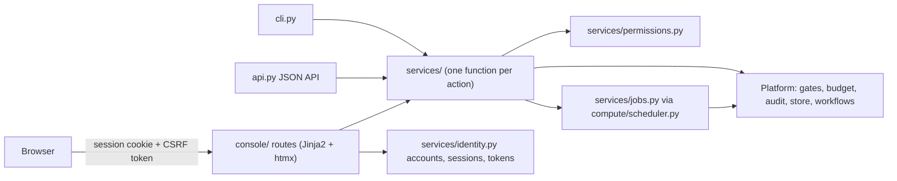

# Phase 2: run the whole platform from a safe browser console

Naming note: the PRD uses "Phase 2" for "First models" (weeks 4 to 7). This
document is the repository's Phase 2 for the operator experience: a browser
console that lets a person with no AI background move the platform forward
without the terminal, while every guardrail keeps holding.

## Goal and success criteria

- A person signs in and does every step in the browser: onboard a data
  source, build and release a dataset, train a tokenizer and a model, freeze an
  eval set, read the evaluation, register and promote the model (or see why
  promotion was refused), and search with citations.
- Every guardrail that holds today still holds through the browser, with a test
  proving it: no pretrained weights, agents cannot decide gates, the requester
  cannot approve, frozen eval sets are immutable, the budget and the kill
  switch apply, document ACLs apply, and the audit log stays append-only and
  verifiable.
- The command line and the JSON API keep working. The console is a third client
  of the same services, not a second implementation.

## The safety gap Phase 2 closes first

Before Phase 2, a decision's actor was a field in the request body behind one
shared key: `GateDecisionRequest.approver`, `BudgetLimitRequest.actor`,
`PolicyRequest.requested_by`, `RunRequest.approve_by`, and the `actor` query
parameter on `/tasks/{id}/transition` and `/alerts/{id}/acknowledge`. In a
browser that would let anyone click "approve" as anyone. Phase 2 makes the
signed-in person the actor everywhere and removes asserted identities from
every governance write.

## Architecture

- One process. The FastAPI app in `src/internal_ai/api.py` mounts the console
  under `/console`. Pages are rendered on the server with Jinja2. htmx is
  vendored into `src/internal_ai/console/static/`, so there is no CDN and no
  Node build.
- `src/internal_ai/services/` holds one typed function per action. Each takes
  an `Actor` (person id, name, roles, groups, and whether the identity was
  authenticated). The CLI, the JSON API and the console all call them.
- The permission map lives in `services/permissions.py`, not in the console,
  so the API and the CLI enforce the same rules as the browser.
- Long steps (dataset build, tokenizer, training, evaluation) run as jobs.
  `services/jobs.py` submits each through `JobScheduler` in
  `compute/scheduler.py`, with an in-process backend. Submission goes through
  the scheduler's budget check and audit trail. The subprocess sandbox is not
  used for these steps because its 4 GB address-space limit is too small to
  load torch. Jobs are persisted in a `console_jobs` table, and the job page
  polls their status.
- Model and data steps call the existing functions in
  `src/internal_ai/workflows.py`. The console adds no training logic.

## Identity and sign-in

- `accounts` table: person id, scrypt password hash with a per-account salt,
  failed-attempt count, lockout time, a must-change-password flag, and created
  and rotated timestamps. Hashing uses stdlib `hashlib.scrypt`.
- `sessions` table: SHA-256 of a random session token, person id, CSRF token,
  created, last seen and expiry. Idle timeout is 30 minutes, the absolute
  timeout is 8 hours, and sign-out deletes the row.
- `api_tokens` table: SHA-256 of a random token, the person it belongs to, a
  label, created and last-used times, and a revoked flag. A token is shown once.
- Accounts exist only for people in the roster. Placeholder people cannot sign
  in, so a real person must replace a placeholder before acting in that role.
- The first account is created from the command line
  (`internal-ai console create-account --person <id>`). It prints a one-time
  password that must be changed at first sign-in. There is no sign-up page.
- Agents have no accounts. Every session- or token-backed call uses
  `actor_kind="human"`, and the agent paths keep their own checks.

## Permissions

Each action names the human roles that may take it. The server checks every
action, whatever the page showed, and records denials in the audit log.

| Action | Roles |
| --- | --- |
| Engage the kill switch, acknowledge alerts, request a gate, ask | any signed-in person |
| Release the kill switch | any signed-in person except the one who engaged it |
| Submit, approve and run a plan; move a task | `program_lead`, `engineering_manager` |
| Change a budget limit (raising needs an approved `budget_increase` gate) | `program_lead`, `finance` |
| Register a data source, build a dataset, split, train a tokenizer | `data_owner`, `ml_lead` |
| Release a dataset (needs an approved `dataset_release` gate) | `ml_lead`, `data_owner` |
| Withdraw a source; confirm a purge requested by someone else | `data_owner`, `compliance` |
| Create an eval set | `ml_lead`, `domain_expert` |
| Freeze an eval set, train, evaluate, register, promote | `ml_lead` |
| Decide a gate | a role the gate requires |
| Propose or confirm a policy decision | `program_lead`, `legal` |
| Manage people, accounts and tokens | `program_lead`, `engineering_manager` |

Agent capabilities in `roles.py` are unchanged.

## Console screens

1. Home: a plain-language next step ("Step 4 of 9: waiting for compliance to
   approve the dataset release"), spend against the cap, the kill switch, open
   alerts and audit-chain health.
2. Build path, one page per step with a one-paragraph explanation: data source,
   dataset, split, tokenizer, eval set, training, model registration,
   evaluation, promotion. Each page shows what it is waiting on and who can
   unblock it.
3. Approvals: gates waiting on my roles, with the evidence inline and a typed
   reason required on approve or reject.
4. Tasks: the board, task history, plan submission, and only the transitions
   allowed by `ALLOWED_TRANSITIONS`.
5. Ask: a question over a released dataset, answered with cited `file:line`
   evidence or "no supporting evidence", filtered by the person's groups.
6. Audit: recent events with filters and a verify-chain button.
7. Administration: people, accounts and tokens; policy proposals; budget limits.

## AI and platform safety measures

Each item has a denial test.

- Two training tracks, and no model upload. The from-scratch track starts
  from random initialisation, and its card records that pretrained weights
  were not used. The alpha track may load only the pinned open base already
  on disk, and its card names that base, revision, and license. Source
  registration refuses paths containing weight files (`.pt`, `.pth`, `.bin`,
  `.safetensors`, `.gguf`, `.onnx`, `.ckpt`) and any path the inventory
  scanner does not classify as `internal`. A released dataset is not edited;
  an improvement is a new version.
- No distillation. Sources are internal files or directories inside the
  configured data roots (`INTERNAL_AI_DATA_ROOTS`, default `<root>/data` and the
  sample directory) and need an approved `new_data_source_access` gate. There is
  no option to import from an AI provider.
- No raw records off the machine. The console calls no external API. Dataset
  pages show statistics and a few scrubbed snippets, and only to groups the
  dataset ACL allows. Sources with detected secrets are refused.
- Frozen eval sets have no edit control. A change is a new eval set behind a new
  `eval_set_freeze` gate.
- Humans decide gates. Decisions come only from authenticated people who hold a
  role the gate requires. The requester's own approval is refused. A gate
  passes only when the approvers' roles cover every required role.
- Two-person rule on irreversible or expensive actions. Promotion, dataset
  release, budget increases and training runs above the cost threshold need an
  approved gate first. A source purge needs a second person to confirm it.
  Withdrawing a source is immediate because it only removes data from future
  use.
- Kill switch: on every page, with a typed reason. Engaging is immediate.
  Releasing needs a different person.
- Spend: before a job starts, the console checks the kill switch, the budget
  scopes, and that the job's cost cap fits in what is left. The trainer records
  actual spend through `BudgetManager.record_spend`.
- Honest results: the evaluation page always shows the keyword baseline next to
  the model. A refused promotion is presented as the safety check working.
- Promotion evidence includes the model card and typed red-team results.

Web security:

- Binds to `127.0.0.1` by default. Another address requires `--allow-remote`
  together with TLS certificate and key paths.
- Session cookie `HttpOnly`, `SameSite=Strict`, and `Secure` when TLS is on. A
  CSRF token is checked on every state-changing request, and every write is a
  POST.
- Content-Security-Policy `default-src 'self'`, `frame-ancestors 'none'`,
  `X-Frame-Options: DENY`, `X-Content-Type-Options: nosniff`,
  `Referrer-Policy: no-referrer`, `Cache-Control: no-store` on console pages,
  and no inline scripts or styles.
- Sign-in is rate limited per client, and an account locks for 15 minutes after
  5 failures. Each attempt is audited.
- Every console action and denial is recorded through `AuditLog.record` with the
  real person id. Nothing writes to `audit_events` directly.

## JSON API and CLI changes

- `X-Internal-Key` still guards the API. Governance writes (plan approval, run
  with approval, gate request and decision, policy proposal and confirmation,
  budget limits, kill switch, task transitions, alert acknowledgement) also
  need `Authorization: Bearer <personal token>`, and the actor comes from the
  token. The old body and query names are gone.
- `scripts/probe.py` keeps its read checks and adds checks that a governance
  write without a personal token is refused.
- The CLI takes `--as <person>` with `INTERNAL_AI_TOKEN`, `INTERNAL_AI_PASSWORD`
  or an interactive password prompt. Once a root has an account, governance
  commands require it and `--by` cannot name someone else. A root with no
  accounts keeps the asserted-name behaviour so the first administrator can be
  set up, and the CLI says so on every governance command.

## Testing

- Unit tests: password hashing, lockout, session expiry, CSRF and the
  permission map.
- Denial tests through FastAPI's `TestClient`, one per guarded action: not
  signed in, wrong role, requester approving their own gate, placeholder
  sign-in, agent deciding a gate, weight files in a source, a path outside the
  data roots, editing a frozen eval set, promotion without the gate, spend over
  the cap, another group's records, a missing CSRF token, a kill-switch release
  by the person who engaged it, and the old asserted-identity API writes.
- End-to-end: the full build path on the synthetic corpus, clicked through with
  a different signed-in person for each approval, ending in a verified audit
  chain.
- Every commit: `.venv/bin/python -m pytest`, `.venv/bin/ruff check .`,
  `.venv/bin/ruff format --check .`.

## Delivery order

1. Services layer extracted from the CLI with no behaviour change.
2. Accounts, sessions, personal tokens, and actors taken from them.
3. Console shell: sign-in, home, approvals, kill switch, audit.
4. Build path pages and background jobs.
5. Ask page and administration pages.
6. Security pass and the denial-test suite, then the tester guide, `STATUS.md`
   and `README.md`.

## Dependencies added

`jinja2`, `python-multipart`, and the htmx script vendored as a static file. No
frontend build tools and no new crypto library.

## Out of scope

- Company single sign-on. Local accounts are designed so SSO can replace the
  sign-in step later.
- Container sandboxing and the Slurm or Kubernetes backends.
- Exposure to the public internet.
