# System diagram

One picture of the whole flow, then what each part means. Mermaid renders on
GitHub; `docs/diagrams/architecture.html` renders it locally, and
`docs/diagrams/architecture.png` is the offline copy.

Status tags inside the boxes: `have` means a module does this today, `part`
means the mechanism exists and the last mile does not, `gap` means there is no
code and it needs a design and a gate before there can be.

```mermaid
%%{init: {"flowchart": {"curve": "basis", "nodeSpacing": 30, "rankSpacing": 46}, "themeVariables": {"fontSize": "14px"}}}%%
flowchart TB
    U["user + own data<br/>after onboarding"]

    SRC["1 register source<br/>licence + legal status<br/>set by a person &middot; have"]
    G1{{"gate: new_data_source_access"}}
    DE["2 data agents<br/>clean, dedupe, scrub, split<br/>deterministic, offline &middot; have"]
    DS["dataset version<br/>immutable, hashed,<br/>lineage &middot; have"]
    G3{{"gate: dataset_release"}}
    MET["use case + success<br/>metric chosen &middot; have"]
    G2{{"gate: eval_set_freeze"}}
    FRZ["frozen eval set<br/>write protected &middot; have"]

    PATH{"20 tokens<br/>per parameter?"}
    SCR["3 from scratch<br/>trainer.py &middot; have"]
    ALP["3 alpha adapter<br/>training/alpha only &middot; have"]
    CAT["catalog.admit + pin.verify<br/>a list is a request,<br/>not a permit &middot; have"]
    G4{{"gate: P6 open weights<br/>+ licence exception"}}

    ADV["4 compute advice<br/>feasible per size,<br/>or why not &middot; have"]
    G5{{"gate: training_run_above_threshold"}}
    DEP["5 deploy trainer<br/>scheduler.py &middot; part"]
    LOC["on premises<br/>LocalBackend &middot; have"]
    RENT["rented GPU<br/>text + question ids only<br/>never records &middot; have"]

    RUN["6 train<br/>stops at the cap &middot; have"]
    EV["evaluate<br/>adapter, its base, keyword &middot; have"]
    G6{{"gate: model_promotion<br/>human, not the requester"}}
    DEV["rework on dev split<br/>have"]

    WRP["7 wrap the weights<br/>guardrails, groups, limits &middot; have"]
    CARD["model card<br/>base, licence, cutoff,<br/>web access &middot; have"]
    G7{{"gate: production_deployment"}}
    SHIP["8 self hosted model<br/>/v1/chat/completions &middot; have"]
    WEB["web access, per install<br/>allowlist + fetch log<br/>off by default &middot; part"]

    TR["9 trace.py<br/>scrubbed, grouped &middot; have"]
    TRI["triage<br/>candidate cases &middot; have"]
    QUAR["10 quarantined source<br/>hold, dual control,<br/>console &middot; have"]

    subgraph FOUND["foundation, always on"]
        direction LR
        AUD["audit.py<br/>append only, chained"] --- BUD["budget.py<br/>caps, kill switch"] --- ROL["roles.py<br/>capability per action"] --- ST["store.py<br/>transition map"] --- OFF["config.py<br/>offline by default"]
    end

    U --> SRC --> G1 --> DE --> DS --> G3 --> PATH
    DE --> MET --> G2 --> FRZ
    PATH -->|yes| SCR
    PATH -->|no| ALP --> CAT --> G4
    SCR --> ADV
    G4 --> ADV
    ADV --> G5 --> DEP
    DEP -->|capacity ok| LOC
    DEP -->|no local capacity| RENT
    LOC --> RUN
    RENT --> RUN
    FRZ -.->|"same items every round"| EV
    RUN --> EV --> G6
    G6 -->|rejected| DEV --> RUN
    G6 -->|approved| WRP --> CARD --> G7 --> SHIP --> TR --> TRI --> QUAR
    WEB -.->|"only where it is switched on"| WRP
    QUAR -.->|"new source, new version,<br/>never new weights"| G1
    QUAR ~~~ AUD
```

## Reading the picture

The four rules the shape is built around:

1. **The metric is frozen before training starts.** `eval_set_freeze` hangs off
   intake, next to the data work, not after evaluation, because a set frozen
   afterwards measures what the model already learned.
2. **The fork is a refusal, not a menu.** The 20-tokens-per-parameter floor in
   `trainer.py` decides the path. When it refuses, the answer is the alpha
   lane; `catalog.admit` then reports what the install would still refuse, and
   the licence exception has to name the revision being loaded.
3. **No metric promotes a model on its own.** `evaluate` leads to a hexagon,
   not to shipping: `model_promotion` is a person's decision, and a rejection
   is what sends the work back to the dev split.
4. **Nothing already trained is edited downstream.** The only edge leaving
   quarantine runs back to step 1 — new source, new version, new adapter, same
   frozen set. "Append to the original weights" has no arrow, because a
   version that changes silently cannot be audited or rolled back.

The foundation band applies to every box above it: each action is
capability-checked in `roles.py`, written to `audit.py`, capped by
`budget.py`, and makes no outbound call unless the install turned
`offline_mode` off.

## Your twelve steps, against the code

| # | Your step | In the code | Status |
| --- | --- | --- | --- |
| 1 | Bring your own data after onboarding | `services/build.py`, `data/pipeline.py`, `G1` | have |
| 2 | Pretrained data agents clean and optimise | `roles.py: data_engineer` | have, but not pretrained |
| 3 | Pick scratch or a listed OSS base | `trainer.py` floor; `catalog.py`, `pin.py`, `G4` | have |
| 4 | An agent computes the compute | `compute/advise.py: advise_dataset` | have |
| 5 | Deploy trainers local or cloud | `compute/scheduler.py`, `LocalBackend`, `SlurmBackend` | part |
| 6 | Finetune by data and model type | `alpha/train.py`, `alpha/pairs.py` | have |
| 7 | Test against available models | `evals/harness.py`, three columns | have |
| 8 | Loop until benchmarks are optimal | budget-gated rounds on the dev split | have, capped |
| 9 | Agents wrap the weights | `serving/app.py`, `guardrails.py`, `permissions.py` | have |
| 10 | Cutoff date, optional internet | card states both; fetch gated per install | have / part |
| 11 | Store new knowledge, keep improving | quarantine hold, dual control, console; conversions refuse until cleared | have |
| 12 | Self-host plus OpenAI-compatible API | `/v1/chat/completions` | have |

## Why one box is still half built

- **`part` on deploy.** `JobScheduler` and `LocalBackend` submit locally, and
  `SlurmBackend` renders the exact `sbatch`, but it has not been run against a
  live scheduler, so the diagram does not claim rented deployment works.

Two boxes this section used to list are built now. The model card states
`knowledge_cutoff` and `web_access` (`training/alpha/card.py`,
`training/alpha/promote.py`). Web access is a `WEB_ACCESS` gate plus a fetch
tool that refuses unless the gate passed, off by default. The learning loop
holds failed traces in `trace_quarantine` under dual control — the proposer
cannot clear — and conversions refuse until the hold is cleared, from the
console or the API.

`docs/architecture.md` describes the code as it stands today; this file
describes the flow, including the parts that refuse.
